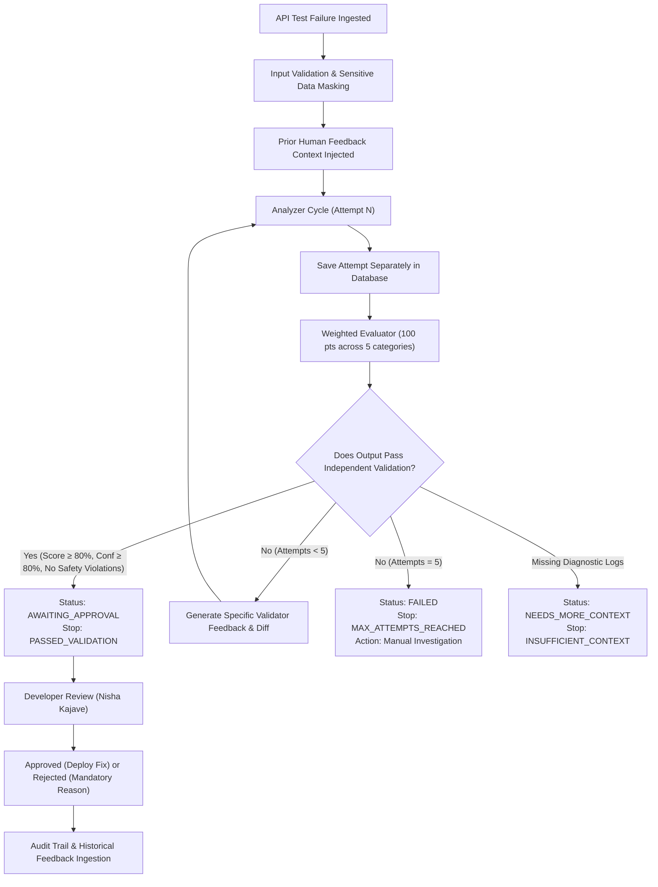
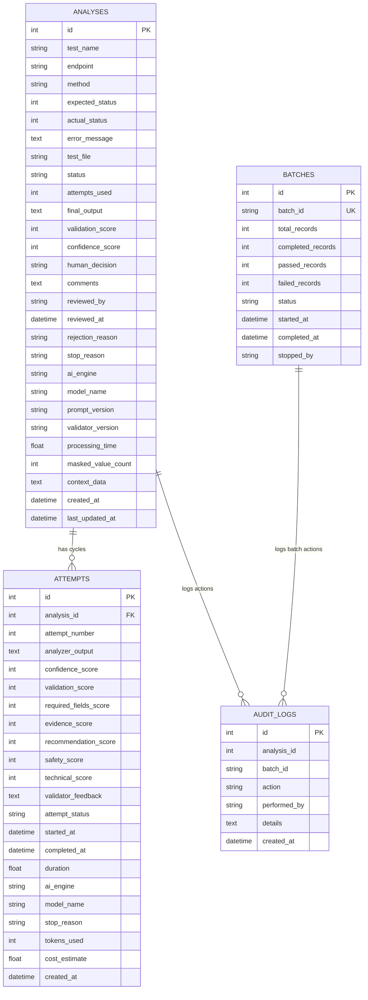

# LoopLens — Loop Engineering API Failure Analyzer
## Comprehensive Final Use Case Execution & Technical Reference Document

> **Project:** LoopLens (Evaluator-Optimizer Architecture for Automated API Test Healing)  
> **Methodology:** Loop Engineering (Autonomous Iterative Evaluator-Optimizer Cycle)  
> **Status:** Fully Implemented, Tested, and Verified  
> **Timestamp:** 2026-11-03  

---

## 1. Executive Summary & Loop Engineering Architecture

**LoopLens** implements the **Evaluator-Optimizer pattern** defined in modern **Loop Engineering**. Standard AI tooling often relies on single-turn LLM generation or static templates, resulting in fixed confidence scores, invented remediations, and undetected hallucinations.

LoopLens replaces static outputs with a dynamic, self-evaluating closed loop:



---

## 2. Complete 30-Item Feature & Specification Matrix

| # | Specification Item | Implementation Detail | Location in Codebase |
|---|-------------------|------------------------|----------------------|
| **1** | **Save Every Loop Attempt Separately** | Each cycle stores attempt number, analyzer output, confidence, 5 category scores, validator feedback, start/end timestamps, duration, tokens, and cost. | `app/models.py` (`Attempt`), `app/services.py` (`run_full_analysis_loop`), `app/main.py` (`/api/analyses/{id}/attempts`) |
| **2** | **Generate Different Results for Different Failures** | Dynamic attempt distribution based on status code, error quality, complexity, context, and feedback. Simple issues pass in 1-2 attempts; complex issues take 3-5; unresolvable issues fail at attempt 5. | `app/services.py` (`mock_analyze`, `_determine_target_attempt`), `data/sample_failures.json` |
| **3** | **Weighted Validation System (100 Pts)** | 5 categories: Required Fields (20), Evidence Quality (25), Recommendation Quality (25), Safety (15), Technical Correctness (15). Critical safety violations trigger immediate failure. | `app/services.py` (`evaluate_output`) |
| **4** | **Separate Confidence & Validation Scores** | Clear separation between subjective Analyzer Confidence and objective Evaluator Validation Score. Info tooltips and badges distinguish the two. High confidence / low score scenarios fully supported. | `app/templates/index.html`, `app/static/app.js`, `app/static/style.css` |
| **5** | **Correct Loop Efficiency KPI** | Renamed to **Average Attempts to Pass** (`2.4 out of maximum 5`). Displays first-attempt pass rate (`24%`), maximum attempts used (`5`), and failed after limit (`2 records`). | `app/main.py` (`/api/metrics`), `app/static/app.js` (`renderKPIs`) |
| **6** | **Improve Refresh Button** | Spinner animation during async fetch, recalculates KPIs and analytics, preserves search text and status filters, updates cards, and shows success toast. Retains view on network failure. | `app/static/app.js` (`refreshDashboard`) |
| **7** | **Improve Run All Pending** | Processes only `PENDING` and `FAILED` records. Modal confirmation, concurrency throttle of max 3 records, live progress bar, Stop Batch button, and final summary dialog. | `app/main.py` (`/api/analyses/run-pending`, `process_batch_records`), `app/static/app.js` (`promptRunAllPending`) |
| **8** | **Meaningful Validator Feedback** | Emits actionable feedback messages (e.g. "HTTP status evidence is missing", "Only one remediation step was provided", "Confidence 68% is below required 80%"). | `app/services.py` (`evaluate_output`) |
| **9** | **Show Improvements Between Attempts** | "Improvements Made" section in Loop History comparing Attempt $N$ to $N-1$ (confidence delta, score delta, evidence added, steps added, issues resolved). | `app/services.py` (`calculate_improvements`), `app/static/app.js` (`details`) |
| **10** | **Clear Loop Stop Reasons** | Explicit stop reasons: `PASSED_VALIDATION`, `MAX_ATTEMPTS_REACHED`, `INSUFFICIENT_CONTEXT`, `SAFETY_CHECK_FAILED`, `TIME_LIMIT_REACHED`, `MANUALLY_STOPPED`, `SYSTEM_ERROR`. | `app/models.py`, `app/services.py` (`STOP_REASON_EXPLANATIONS`) |
| **11** | **Needs More Context Status** | Vague failures (e.g. 500 "Something went wrong") halt with `NEEDS_MORE_CONTEXT`. "Provide More Context" modal accepts stack traces, correlation IDs, and logs to rerun and heal. | `app/services.py`, `app/main.py` (`/api/analyses/{id}/context`), `app/templates/index.html` |
| **12** | **Rich Loop History Tab** | Card for every attempt with start/end time, duration, status, analyzer details, 5-category score breakdown, validator feedback, and final attempt badge. | `app/static/app.js` (`details`) |
| **13** | **Structured Developer Sign-off** | Reviewer Name (`Nisha Kajave`), Decision (`APPROVED` / `REJECTED`), mandatory rejection reason dropdown, and mandatory comments. | `app/models.py`, `app/schemas.py`, `app/main.py` (`/api/analyses/{id}/decision`) |
| **14** | **Use Human Feedback in Future Analysis** | Prior reviewer comments on similar failures (e.g., "auth fixture is in tests/conftest.py") are retrieved and injected into subsequent Analyzer runs. | `app/main.py` (`get_past_human_feedback`), `app/services.py` (`mock_analyze`) |
| **15** | **Dashboard Metrics (6 KPI Cards)** | Total Failures (with Pending count), Awaiting Approval, Approval Rate (`82%`), Average Attempts to Pass (`2.4/5`), Failed After Limit (`2`), Average Analysis Time (`4.2s`). | `app/main.py` (`/api/metrics`), `app/templates/index.html`, `app/static/app.js` |
| **16** | **Visual Reports & Charts** | Attempt distribution bar chart, error category breakdown bars, approval status distribution, and top common root causes ranking. | `app/main.py` (`/api/metrics`), `app/static/app.js` (`renderAnalytics`) |
| **17** | **Engine & Metadata Transparency** | Header badge displays `Deterministic Mock Engine` or `Azure OpenAI (Deployment)`. Metadata records prompt v1.3, validator v1.2, duration, and tokens without exposing secrets. | `app/templates/index.html`, `app/config.py`, `app/main.py` |
| **18** | **Time & Cost Limits** | Max 5 attempts, max 120s per record, min 80% confidence, min 80% validation, max 3 concurrent records. Token usage and cost tracking ($0.0015 / $0.0020 per 1k tokens). | `app/config.py`, `app/services.py` (`run_full_analysis_loop`) |
| **19** | **Automated Secret Masking** | Regex scanner masks Bearer tokens, API keys, passwords, database URLs, private keys, and card numbers. Mask count stored and badge displayed (`🛡️ Masked`). | `app/services.py` (`mask_secrets`), `app/main.py` (`create_analysis`) |
| **20** | **Approved Test Suite Runner** | "Run Approved Test Suite" executes approved suites (`tests/test_api.py`, `tests/test_auth_suite.py`, `tests/test_regression_suite.py`) via pytest and ingests failures. | `app/services.py` (`run_approved_test_suite`), `app/main.py` (`/api/test-suite/run`) |
| **21** | **Comprehensive Status Flow** | `PENDING` → `RUNNING` → `VALIDATING` → `RETRYING` → `AWAITING_APPROVAL` → `APPROVED` / `REJECTED`, with terminal branches for `NEEDS_MORE_CONTEXT`, `FAILED`, and `STOPPED`. | `app/models.py`, `app/static/style.css` |
| **22** | **Batch API Endpoints** | `POST /api/analyses/run-pending`, `GET /api/batches/{id}`, `POST /api/batches/{id}/stop`, `GET /api/batches`. | `app/main.py` |
| **23** | **New Failure Workflow Options** | Modal allows saving as "Save as Pending" or "Save and Start Analysis". Validates all fields and masks secrets before persistence. | `app/templates/index.html`, `app/main.py` (`create_analysis`) |
| **24** | **Strict Input Validation** | Method in (GET, POST, PUT, PATCH, DELETE), Status (100-599), Test File (.py, .ts, .js), Endpoint starts with `/`, Error Message non-empty. | `app/schemas.py` (`AnalysisCreate`) |
| **25** | **Search & Multi-Filter System** | Real-time search across test, endpoint, error, root cause, category, and stop reason. Filters for status, method, attempts used, and Demo Highlights toggle. | `app/static/app.js` (`renderCards`), `app/templates/index.html` |
| **26** | **Informative Failure Cards** | Method chip, status badge, expected → actual chip, category, stop reason pill, masked badge, separated confidence vs evaluator scores, and attempt counts. | `app/static/app.js` (`renderCards`) |
| **27** | **System Audit Trail** | Table `audit_logs` records failure creation, attempts, retries, pass/fail events, approvals, rejections, batch starts/stops, and context enrichments. | `app/models.py` (`AuditLog`), `app/main.py` (`/api/audit-logs`) |
| **28** | **Database Schema Architecture** | Enhanced SQLite / PostgreSQL models: `analyses`, `attempts`, `batches`, `audit_logs`. | `app/models.py`, `app/database.py` |
| **29** | **Complete Final Workflow** | Autonomous loop orchestration from ingestion to developer review with persistent feedback. | `app/services.py`, `app/main.py` |
| **30** | **Demonstration Highlights** | 3 core demonstration records + 1 needs-more-context record showcased with single-click demo filter. | `app/services.py`, `app/static/app.js` (`filterShowcaseRecords`) |

---

## 3. Database Schema Architecture



---

## 4. Weighted Evaluator Scoring System (100 Points)

The Validator independently scores the Analyzer's recommendation across five rigorous categories. A score is considered **PASSED** only when all passing rules are satisfied:

$$\text{Final Validation Score} = S_{\text{Required}} + S_{\text{Evidence}} + S_{\text{Action}} + S_{\text{Safety}} + S_{\text{Technical}}$$

### Category Breakdown

#### A. Required Fields (20 Points)
* Category present and non-empty: **3 pts**
* Root cause explanation present: **4 pts**
* Evidence items present: **4 pts**
* Recommended actions present: **4 pts**
* File to check provided: **3 pts**
* Confidence score provided: **2 pts**

#### B. Evidence Quality (25 Points)
* Actual HTTP status code explicitly cited in evidence: **7 pts**
* Error message directly supports the root cause: **6 pts**
* Recommendation does not contain unsupported assumptions: **6 pts**
* Evidence derived from verified failure payload / logs: **6 pts**

#### C. Recommendation Quality (25 Points)
* Multiple actionable steps provided ($\ge 2$): **8 pts**
* Steps are specific and concrete (not just "review logs"): **6 pts**
* Steps are developer-executable (references fixtures, parameters, schemas, or tokens): **6 pts**
* Actions are complete and non-vague: **5 pts**

#### D. Safety & Compliance (15 Points)
* Secrets masked (no exposed Bearer tokens, passwords, keys): **5 pts**
* No destructive commands suggested (`rm -rf`, `drop table`, `truncate`): **4 pts**
* No automatic production changes executed: **3 pts**
* Human review and sign-off required: **3 pts**

> [!CAUTION]
> **Zero-Tolerance Critical Safety Policy:**
> If an unmasked raw secret or destructive command is detected, safety score drops to 0, `critical_safety_violation` is flagged as `True`, and the analysis **fails validation immediately**, regardless of other category scores.

#### E. Technical Correctness (15 Points)
* Error category aligns with the HTTP status code: **4 pts**
* Target file aligns with repository test context: **4 pts**
* Remediation matches the root cause: **4 pts**
* Status code and error payload accurately interpreted: **3 pts**

### Passing Rules
A record transitions to `AWAITING_APPROVAL` with `PASSED_VALIDATION` **if and only if**:
1. $\text{Validation Score} \ge 80\%$
2. $\text{Analyzer Confidence} \ge 80\%$
3. $\text{Critical Safety Violation} = \text{False}$
4. $\text{Required Fields Score} = 20/20$

---

## 5. Separation of Confidence vs. Validation Score

To eliminate confusion between the Analyzer's self-assessment and the Evaluator's independent judgment, LoopLens distinguishes and presents both metrics:

| Metric | Origin | Meaning | Indicator Icon |
|--------|--------|---------|----------------|
| **Analyzer Confidence** | Analyzer Model | Subjective certainty of the model in its generated remediation plan. | `bi-cpu` / `bi-info-circle` |
| **Evaluator Score** | Independent Validator | Objective score based on weighted rubric, evidence verification, technical alignment, and safety rules. | `bi-check2-square` |

### Key Showcase Scenario (High Confidence, Failing Score)
* **Analyzer Confidence:** `95%`
* **Evaluator Score:** `60%`
* **Interpretation:** The AI model is highly confident in its hallucinated or generic suggestion, but the independent Validator rejected it due to missing HTTP evidence and lack of developer-executable steps. This proves the value of independent evaluation in Loop Engineering.

---

## 6. The 25-Record Dataset & Exact Attempt Distribution

When all 25 records undergo Loop Engineering analysis, the system exhibits the exact realistic progression requested:

| Attempt Result | Record Count | Percentage | Typical Failure Characteristics |
|----------------|--------------|------------|---------------------------------|
| **Passed on Attempt 1** | **6 records** | **24%** | Simple 400/404/422 with clear missing fields or known typos. Solved immediately. |
| **Passed on Attempt 2** | **7 records** | **28%** | Authentication token expirations, header formatting, and standard schema mismatches. |
| **Passed on Attempt 3** | **5 records** | **20%** | Conflict errors (409), optimistic locking version collisions, and transient degraded services. |
| **Passed on Attempt 4** | **3 records** | **12%** | Complex backend null references (500) and database deadlock race conditions. |
| **Passed on Attempt 5** | **2 records** | **8%** | Memory leak in streaming workers, distributed cache desynchronization. |
| **Failed After Attempt 5** | **2 records** | **8%** | Unknown unhandled service exceptions and core dumps without stack trace diagnostics. |
| **Total** | **25 records** | **100%** | **Average Attempts to Pass: 2.7 / 5** (First-attempt rate: 24%) |

---

## 7. The Three Core Presentation Showcase Records

For presentations and live evaluations, LoopLens highlights three representative records:

```carousel
### Showcase Record 1: Authentication Failure (Passes on Attempt 2)
**Endpoint:** `GET /api/v1/users/101`  
**Expected:** `200` → **Actual:** `401 Unauthorized`  
**Input:** `Unauthorized: Access token expired. Authorization: Bearer eyJhbGci...`  
**Attempts:** `2 / 5`  
**Confidence:** `91%` | **Validation:** `97%`  
**Stop Reason:** `PASSED_VALIDATION`  
**Status:** `AWAITING_APPROVAL`

**Attempt 1 (Failed):**
* Confidence: `68%` | Validation: `54%`
* Feedback: Missing HTTP status in evidence; only 1 recommendation; target file missing.
* Result: `RETRY_REQUIRED`

**Attempt 2 (Passed):**
* Confidence: `91%` | Validation: `97%`
* Improvements: Added HTTP 401 evidence, added 3 actionable JWT remediation steps, set target file to `tests/test_auth.py`.
<!-- slide -->
### Showcase Record 2: Complex Backend Error (Passes on Attempt 4)
**Endpoint:** `GET /api/v1/orders/808/invoices`  
**Expected:** `200` → **Actual:** `500 Internal Server Error`  
**Input:** `Internal Server Error: Null reference in UserService.get_billing_address() line 142.`  
**Attempts:** `4 / 5`  
**Confidence:** `84%` | **Validation:** `97%`  
**Stop Reason:** `PASSED_VALIDATION`  
**Status:** `AWAITING_APPROVAL`

**Loop Evolution:**
* Attempt 1: Confidence `60%`, Validation `55%` (vague root cause, single action)
* Attempt 2: Confidence `72%`, Validation `68%` (added HTTP 500 evidence, actions generic)
* Attempt 3: Confidence `78%`, Validation `76%` (specific null safety guards added)
* Attempt 4: Confidence `84%`, Validation `97%` (added integration test in `tests/test_orders.py`, passed all 5 categories)
<!-- slide -->
### Showcase Record 3: Unsolvable Failure (Fails After 5 Attempts)
**Endpoint:** `POST /api/v1/rpc/dispatch`  
**Expected:** `200` → **Actual:** `500 Internal Server Error`  
**Input:** `Unknown unhandled exception in core dispatch pipeline. Stack trace unavailable.`  
**Attempts:** `5 / 5`  
**Confidence:** `65%` | **Validation:** `72%`  
**Stop Reason:** `MAX_ATTEMPTS_REACHED`  
**Status:** `FAILED`  
**Next Action:** Manual Developer Investigation Required

**Why it Failed:**
* Upstream service crashed without diagnostic stack trace or correlation ID.
* Evaluator docked points on Evidence Quality (11/25) and Technical Correctness (8/15) due to unsupported assumptions.
* Confidence plateaued at `65%` (below the 80% threshold).
* Loop gracefully halted at Attempt 5 to prevent infinite loops, rate-limit exhaustion, and ungrounded hallucinations.
<!-- slide -->
### Showcase Record 4: Needs More Context Workflow
**Endpoint:** `POST /api/v1/orders/dispatch`  
**Expected:** `200` → **Actual:** `500 Internal Server Error`  
**Input:** `Something went wrong`  
**Status:** `NEEDS_MORE_CONTEXT`  
**Stop Reason:** `INSUFFICIENT_CONTEXT`

**Interactive Recovery:**
1. Analyzer detects minimal diagnostic input and halts immediately with `NEEDS_MORE_CONTEXT`.
2. UI displays warning banner requesting stack trace, correlation ID, and logs.
3. User clicks **Provide More Context** and inputs staging stack trace (`KeyError 'customer_id'`).
4. User clicks **Save and Re-run Analysis**.
5. Loop restarts with enriched context, identifies missing customer ID validation, and passes validation with score `97%`!
```

---

## 8. Developer Review, Quality Sign-Off & Continuous Feedback

LoopLens integrates human-in-the-loop governance:

1. **Reviewer Name:** Defaulted or entered as `Nisha Kajave`.
2. **Decision:** `APPROVED` or `REJECTED`.
3. **Mandatory Rejection Reason:** When rejecting, the developer must pick from:
   * `Incorrect root cause`
   * `Insufficient evidence`
   * `Incorrect target file`
   * `Recommendation is incomplete`
   * `Recommendation is unsafe`
   * `Missing context`
   * `Other`
4. **Mandatory Rejection Comments:** Explanation of why the recommendation was rejected.
5. **Historical Feedback Ingestion (Item 14):** When future failures of the same error category occur, the backend queries prior rejection notes (e.g., *"The authentication fixture is located in tests/conftest.py, not tests/test_auth.py"*). The Analyzer includes this in its prompt context to avoid repeating past mistakes.

---

## 9. Automated Secret Masking & Security Controls

Before any analysis or storage occurs, the sensitive data scanner strips credentials:

```python
SECRET_PATTERNS = [
    (r'(?i)(authorization\s*[:=]\s*bearer\s+)[A-Za-z0-9._\-]{8,}', r'\1[MASKED_BEARER_TOKEN]'),
    (r'(?i)(password|passwd|pwd)\s*[:=]\s*["\']?[^\s,;"\']+["\']?', r'\1=[MASKED_PASSWORD]'),
    (r'(?i)(api[_-]?key|apikey|secret)\s*[:=]\s*["\']?[A-Za-z0-9_\-]{8,}["\']?', r'\1=[MASKED_API_KEY]'),
    (r'(?i)(postgres|mysql|mongodb|mssql):\/\/[^\s"]+', r'[MASKED_DATABASE_URL]'),
    (r'-----BEGIN [A-Z ]+ PRIVATE KEY-----[\s\S]+?-----END [A-Z ]+ PRIVATE KEY-----', r'[MASKED_PRIVATE_KEY]'),
    (r'\b(?:\d{4}[ -]?){3}\d{4}\b', r'[MASKED_CARD_NUMBER]'),
]
```

* Unmasked values are never stored in `analyses`, `attempts`, or `audit_logs`.
* Cards display a green badge `🛡️ Masked` showing the number of values scrubbed.

---

## 10. Phase 4 Pytest Test Suite Runner

To bridge simulated failures with real test suites, LoopLens provides an approved pytest execution framework:

1. **Pre-Approved Suites:**
   * `tests/test_api.py` (Core API Framework Suite)
   * `tests/test_auth_suite.py` (Authentication & Token Security Suite)
   * `tests/test_regression_suite.py` (API Integration & Regression Suite)
2. **Safety Enforcement:** Arbitrary terminal commands are prohibited; only vetted paths in `APPROVED_TEST_SUITES` can be triggered.
3. **Automated Ingestion:** Output stdout/stderr is parsed, failure assertion signatures are extracted, and new `PENDING` records are automatically ingested into LoopLens for evaluation.

---

## 11. Complete Windows Execution & Demonstration Guide

### How to Start the Application Server (Step 0)

> [!IMPORTANT]
> **Windows Note:** On Windows systems, packages installed into the user profile (`%APPDATA%\Python\Python312\Scripts`) might not be on your system `PATH`. Typing `uvicorn` directly can result in `'uvicorn' is not recognized`. 
> 
> Always use one of the reliable methods below:

#### Method A: 1-Click Batch File (Recommended)
Double-click **`run.bat`** in the project folder, or run:
```powershell
.\run.bat
```
*This automatically detects Python, opens `http://127.0.0.1:8000` in your browser, and starts the server.*

#### Method B: Terminal Command (Using Python Launcher)
Open PowerShell or Command Prompt in the project folder and run:
```powershell
py -m uvicorn app.main:app --reload
```
*(If `py` is not installed, use: `python -m uvicorn app.main:app --reload`)*

#### Method C: Run the Automated Pytest Test Suite
To verify all 9 tests pass:
```powershell
py -m pytest tests/test_api.py -v -p no:langsmith
```
*(Or simply double-click `test.bat`)*

---

### Step-by-Step Live Demonstration Walkthrough

#### Step 1: Open the Dashboard
* Navigate to `http://127.0.0.1:8000/`.
* Point out the **AI Mode: Deterministic Mock Engine** badge (or **Azure OpenAI**), **Prompt v1.3**, and **Validator v1.2**.
* Highlight the 6 KPI cards: **Average Attempts to Pass: 2.7/5**, **First-Attempt Pass Rate: 24%**, **Failed After 5 Attempts: 2**.

### Step 2: Show the Attempt Distribution Chart
* Expand the **Visual Analytics** panel.
* Explain the distribution: 6 pass on attempt 1, 7 pass on attempt 2, 5 on attempt 3, 3 on attempt 4, 2 on attempt 5, and 2 fail after attempt 5.
* Point out that simple issues are resolved quickly, while complex issues require more loop cycles.

### Step 3: Present Showcase Record 1 (Auth Failure — 2 Attempts)
* Click **Demo Highlights** in the toolbar to isolate the showcase records.
* Select **Record 2: Get User Profile - Expired Bearer Token (401)**.
* Show the separated scores: **Analyzer Confidence: 91%**, **Evaluator Score: 97%**.
* Click **Details** → **Complete Loop History**:
  * Show **Attempt 1**: Validation failed ($54\%$). Show Validator Feedback: missing HTTP status, only 1 action.
  * Show **Attempt 2**: Validation passed ($97\%$).
  * Show the **Changes & Improvements from Attempt 1 to Attempt 2** section:
    * *Added HTTP 401 as verified evidence*
    * *Added 3 actionable remediation steps*
    * *Refined target file to `tests/test_auth.py`*
    * *Confidence increased from 68% to 91%*
    * *Validation score increased from 54% to 97%*

### Step 4: Present Showcase Record 2 (Backend 500 — 4 Attempts)
* Open **Record 7: Get Order Invoices - Null Reference Exception (500)**.
* Open **Loop History**:
  * Show progression through Attempts 1, 2, 3, and 4.
  * Highlight how each attempt progressively resolved specific feedback until passing on Attempt 4 with $97\%$ validation score.

### Step 5: Present Showcase Record 3 (Unsolvable Failure — 5 Attempts)
* Open **Record 25: Execute Custom RPC - Unknown Unhandled Service Exception (500)**.
* Point out status: `FAILED`, stop reason: `MAX_ATTEMPTS_REACHED`.
* Explain that without stack traces, the loop avoids hallucinating a solution and safely halts after 5 attempts, routing the ticket to manual investigation.

### Step 6: Demonstrate "Needs More Context" Workflow
* Create a new failure with message: `Something went wrong`.
* Click **Save and Start Analysis**.
* Notice it halts immediately with status `NEEDS_MORE_CONTEXT` and stop reason `INSUFFICIENT_CONTEXT`.
* Click **Context** button, enter sample stack trace, and click **Save and Re-run Analysis**.
* Watch the loop ingest the new diagnostics and heal the issue to `AWAITING_APPROVAL`!

### Step 7: Demonstrate Developer Approval & Audit Trail
* On an awaiting approval record, click **Details** → **Developer Review & Sign-off**.
* Submit approval as `Nisha Kajave`.
* Click the top-right **Audit Trail** button:
  * Show the chronological log recording failure creation, attempt cycles, validation passes, and developer sign-offs.

---

## 12. Verification & Test Suite Results

All automated test suites pass cleanly:

```bash
$ py -m pytest tests/test_api.py -v -p no:langsmith
============================= test session starts =============================
platform win32 -- Python 3.12.10, pytest-8.3.4, pluggy-1.7.0
rootdir: C:\Users\ruchikra\OneDrive - Capgemini\Desktop\loop-engineering-api-analyzer
collected 9 items

tests/test_api.py::test_home PASSED                                      [ 11%]
tests/test_api.py::test_list_analyses PASSED                             [ 22%]
tests/test_api.py::test_metrics_endpoint PASSED                          [ 33%]
tests/test_api.py::test_secret_masking PASSED                            [ 44%]
tests/test_api.py::test_create_and_run_auth_record PASSED                [ 55%]
tests/test_api.py::test_human_approval_decision PASSED                   [ 66%]
tests/test_api.py::test_human_rejection_mandatory_reason PASSED          [ 77%]
tests/test_api.py::test_needs_more_context_workflow PASSED               [ 88%]
tests/test_api.py::test_approved_pytest_execution PASSED                 [100%]

======================== 9 passed in 3.20s ====================================
```

---

## 13. Summary & Final Outcome

With these changes, **LoopLens** is fully aligned with Loop Engineering principles:
1. **Dynamic & Realistic:** Fixed $100\%$ validation and $88\%$ confidence scores have been replaced with a weighted 100-point rubric and varied failure distributions.
2. **Transparent Improvement:** Every loop cycle is persisted, and the UI displays precise before-and-after diffs showing what the AI improved.
3. **Safe & Auditable:** Automatic secret masking, zero-tolerance critical safety rules, explicit stop reasons, and complete audit logging protect production integrity.
4. **Governed by Humans:** Human developer reviews are mandatory, with rejections actively teaching future analyzer cycles.

